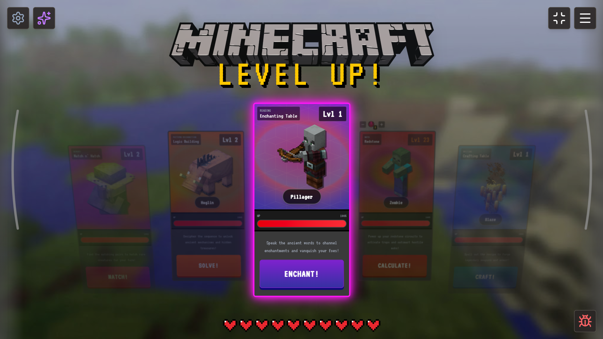
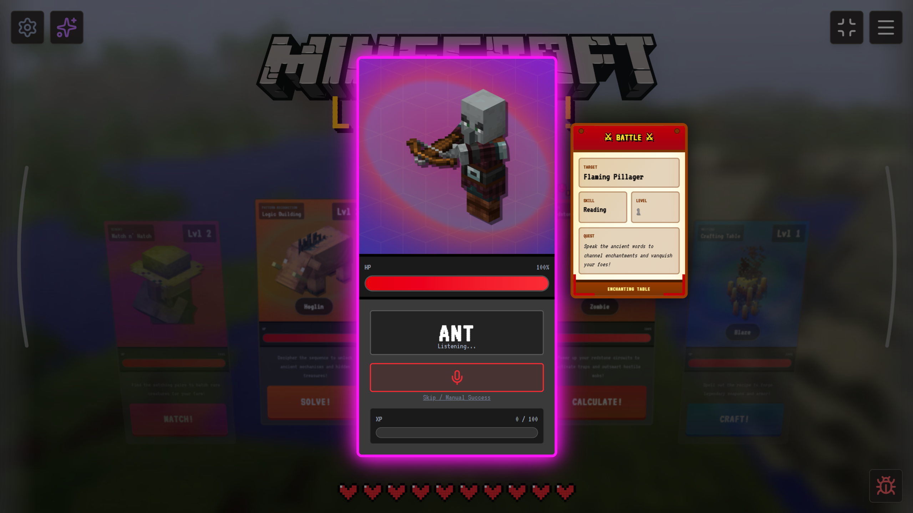
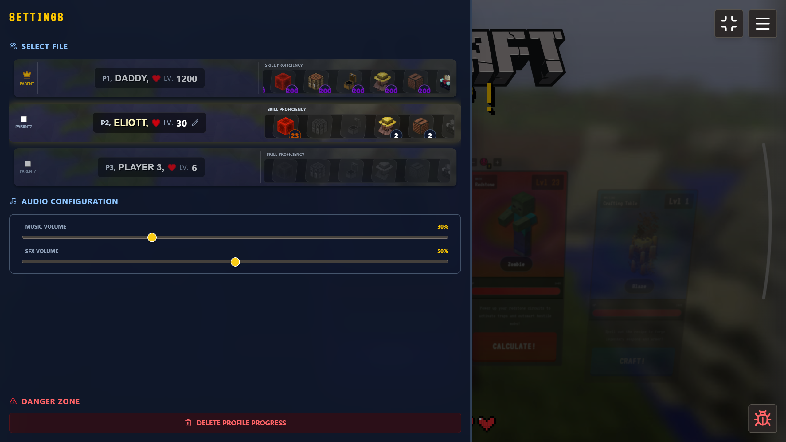
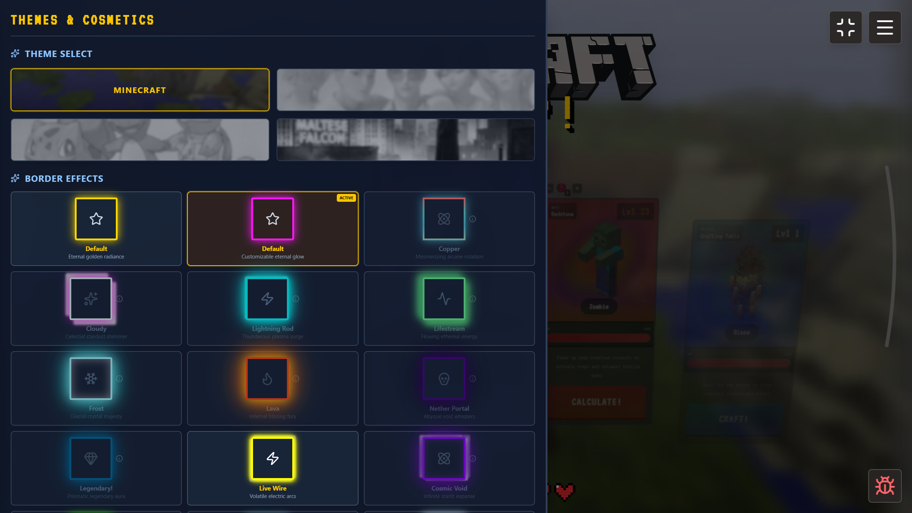
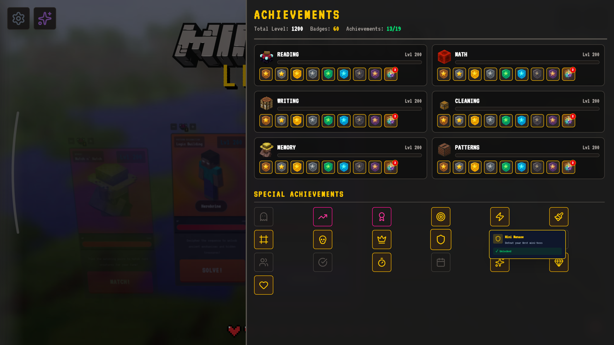
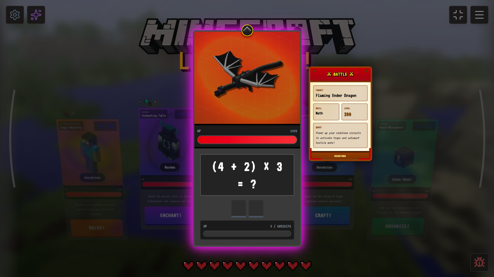
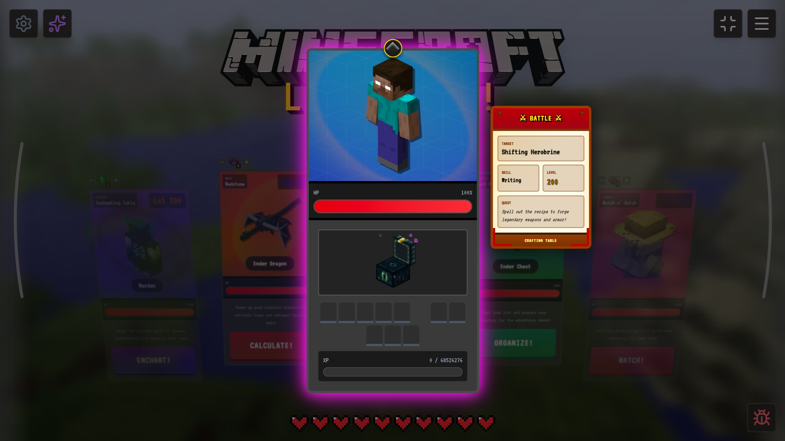
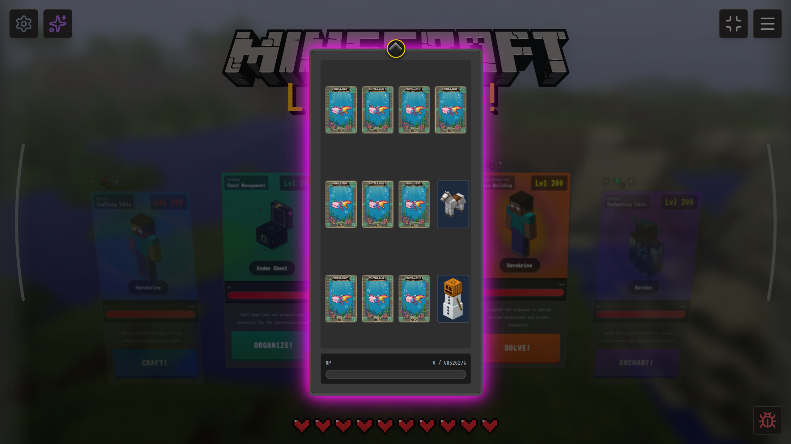
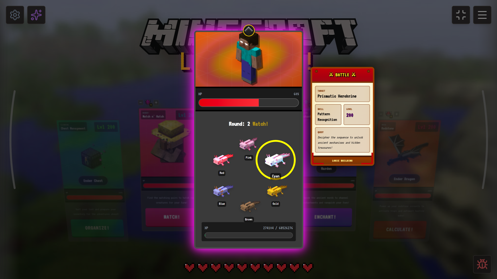

# Level Up RPG

An educational RPG game where children learn academic skills (reading, math, writing, memory, pattern recognition) through Minecraft-themed combat encounters.



## Features

- **6 Minigames**: Reading (voice recognition), Math, Writing/Spelling, Cleaning (inventory sorting), Memory (card matching), Patterns (sequence recognition)
- **RPG Progression**: Level up skills, fight hostile mobs, minibosses, and bosses
- **7 Difficulty Tiers** per skill, with parental controls for the hardest level
- **4 Themes**: Minecraft, K-Pop Demon Hunters, Pokemon, Spy
- **3 Save Profiles** with persistent localStorage
- **Achievement System** with tiered progression (Bronze → Mythic)
- **Cosmetic Borders** unlocked via badges and achievements
- **Sound System** with BGM, UI effects, and per-mob sounds
- **Voice Recognition** for the Reading skill (Web Speech API)

## Screenshots

| | | |
|---|---|---|
|  |  |  |
|  |  |  |
|  |  | |

## Tech Stack

- **React 19** — UI framework
- **Vite** (rolldown-vite) — Build tool
- **Tailwind CSS 4** — Styling
- **Lucide React** — Icons
- **Electron** — Desktop app wrapper
- **Web Speech API** — Voice recognition for Reading skill

## Getting Started

### Prerequisites

- Node.js 18+
- npm

### Installation

```bash
git clone <repo-url>
cd G-ING-400-BAR-4-1-codewash-5
npm install
```

### Run in Browser

```bash
npm run dev
```

Opens at `http://localhost:5173`

### Run as Desktop App (Electron)

```bash
npm run electron:dev
```

### Build for Production

```bash
npm run build
```

### Package as Portable .exe (Windows)

```bash
npm run electron:build
```

Outputs `LevelUpRPG-Portable.exe` in `release/`.

## Project Structure

```
src/
├── App.jsx                    # Main game component (state, logic, UI)
├── main.jsx                   # React entry point
├── index.css                  # Global styles (Tailwind)
├── constants/
│   ├── gameData.jsx           # Mobs, themes, skills, words, items
│   ├── achievements.js        # Achievement definitions
│   └── assets.js              # Asset path references
├── utils/
│   ├── gameUtils.js           # Damage, XP, mob selection, math problems
│   ├── soundManager.js        # BGM & SFX playback
│   ├── achievementUtils.js    # Achievement tracking
│   └── mobDisplayUtils.js     # Mob visual effects
└── components/
    ├── skills/SkillCard.jsx   # All 6 minigame implementations
    ├── ui/                    # SafeImage, MobWithAura, Hearts, Toasts...
    ├── drawers/               # Menu, Settings, Cosmetics side panels
    ├── modals/                # Reset, Bug Report dialogs
    └── profile/ProfileCard.jsx

electron/
└── main.cjs                   # Electron main process

public/assets/
├── mobs/                      # 76 mob images (friendly, hostile, boss, miniboss, axolotl)
├── sounds/                    # BGM, UI SFX, mob sounds
├── themes/                    # Theme backgrounds & logos
├── badges/                    # 9 tier badge images
├── difficulty/                # 7 difficulty tier images
└── items/                     # Items & chest blocks
```

## Available Scripts

| Script | Description |
|--------|-------------|
| `npm run dev` | Start dev server |
| `npm run build` | Production build |
| `npm run preview` | Preview production build |
| `npm run lint` | Run ESLint |
| `npm run electron:dev` | Build + launch Electron |
| `npm run electron:build` | Package as portable .exe |

## Game Mechanics

### Skills & Minigames

| Skill | Fantasy Name | Mechanic |
|-------|-------------|----------|
| Reading | Enchanting Table | Speak words aloud (voice recognition) |
| Math | Redstone Power | Solve math problems (addition → PEMDAS) |
| Writing | Crafting Table | Spell Minecraft items letter by letter |
| Cleaning | Chest Management | Sort items into correct chest types |
| Memory | Match n' Hatch | Flip cards to find matching pairs |
| Patterns | Logic Building | Repeat axolotl color sequences |

### Progression

- **Levels 1-9, 11-19...**: Fight hostile mobs
- **Every 10th level**: Miniboss encounter
- **Every 20th level**: Boss battle
- **Badge tiers**: Wood (20) → Stone (40) → Gold (60) → Iron (80) → Emerald (100) → Diamond (120) → Netherite (140) → Obsidian (160)
